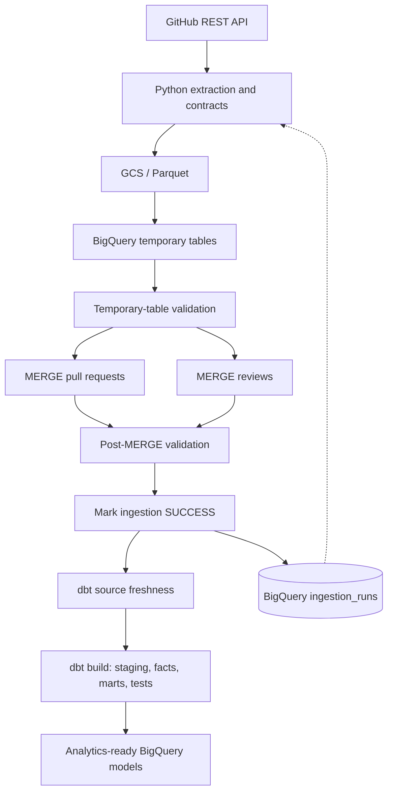
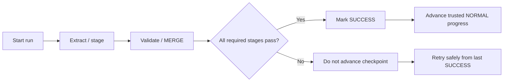

# GitHub Engineering Analytics

**A stateful, recoverable batch analytics pipeline for GitHub pull requests and reviews.**

    

> **Project status:** This repository demonstrates batch ingestion, reliability and recovery, warehouse modeling, and data-quality engineering—not a deployed real-time analytics service.

## Overview

GitHub Engineering Analytics extracts pull-request and review data from the GitHub REST API, stages it as Parquet in Google Cloud Storage, merges it into BigQuery Bronze tables, and transforms it into analytics-ready dbt models. Apache Airflow orchestrates the process, including run-state tracking, validation, and downstream modeling.

The central design goal is **safe, repeatable ingestion**: failed runs should be recoverable without losing data, duplicating entities, or incorrectly advancing the ingestion checkpoint.

## Architecture



**Stack:** Python · GitHub REST API · Google Cloud Storage · BigQuery · dbt · Apache Airflow.

## Repository layout

```text
github_proj/
├── api.py                      # GitHub PR/review extraction
├── helpers.py                  # API pagination, GCS, control-table helpers
├── contract.py                 # Source-record contract checks
├── bq_connect.py               # BigQuery operations and MERGE SQL
├── main.py                     # Ingestion entry points
├── dags/
│   └── flow.py                 # Airflow DAG
├── github_analytics/           # dbt project
│   ├── dbt_project.yml
│   ├── models/
│   │   ├── sources.yml
│   │   ├── stg_pull_requests.sql
│   │   ├── stg_reviews.sql
│   │   └── gold/
│   │       ├── fct_pr_metrics.sql
│   │       └── mart_monthly_repo_activities.sql
│   └── tests/                   # Custom SQL assertions
└── README.md
```

Local virtual environments, credentials, generated datasets, dbt build artifacts, and logs are intentionally excluded from version control.

## Ingestion and orchestration

### 1. Incremental extraction

NORMAL runs use the latest successful NORMAL ingestion checkpoint, plus a configurable lookback, to define the next extraction window:

```text
extraction_from = latest_successful_NORMAL_watermark - lookback
extraction_to   = current_run_watermark
```

For example, with a two-day lookback and daily runs, the extraction interval is typically **three days**: two days before the previous successful watermark through the current run boundary. If a run fails, the checkpoint does not advance, so the next run reprocesses the necessary overlap.

Pull requests are discovered through GitHub's `updated_at`-descending pagination and bounded by the extraction interval. The upper boundary is fixed for each run rather than moving during extraction.

**Limitation:** A finite lookback tolerates bounded lateness; it does not guarantee that every arbitrarily late source correction will be discovered. Complete detection of out-of-window changes would require an additional source or reconciliation mechanism, which this project does not implement.

### 2. Staging and Bronze ingestion

Python extracts PRs and reviews, writes Parquet to GCS, and loads batches into temporary BigQuery tables. Validation runs before writes to persistent Bronze tables.

Bronze maintains distinct entity grains:

| Dataset | Grain | Write identity |
|---|---|---|
| Pull requests | One row per PR | PR ID |
| Reviews | One row per review | Review ID |

The PR MERGE only updates an existing record when the incoming `updated_at` is newer. Key-based matching prevents duplicate entities, while the timestamp guard prevents an older PR snapshot from overwriting a newer one.

### 3. Recovery and run state

The pipeline is designed for **at-least-once processing with idempotent writes**, not exactly-once execution. Retrying a run may repeat extraction and MERGE operations, but repeating valid operations should not create duplicate entities or regress PR state.

The BigQuery `ingestion_runs` control table tracks run identity, extraction boundaries, counts, status, and timing. A run becomes eligible to advance the NORMAL watermark **only after required ingestion operations and validations complete**.



A failed run may already have written some Bronze rows. Its non-SUCCESS status does **not** imply that all previous writes were rolled back. Idempotent reprocessing is what makes recovery safe.

### 4. NORMAL vs BACKFILL

Historical backfills accept explicit extraction boundaries and are recorded separately from NORMAL runs. A successful backfill must **not** advance the NORMAL watermark: processing historical June data, for example, is not evidence that current October ingestion has progressed.

This separation supports historical repair without disrupting scheduled incremental progress.

## Data quality and contracts

The ingestion layer applies source-record validation, including required fields and expected value domains. Malformed records can be rejected while valid records continue under the project's partial-success policy. Rejection severity matters as well as rejection count: a systematic schema change is different from an isolated malformed record.

The dbt layer adds structural and business-rule tests, including:

- Non-null and unique identifiers.
- PR-to-review referential relationships.
- Accepted review states.
- PR outcome consistency.
- Non-negative monthly metrics and unique monthly mart grain.
- Source freshness checks.

These checks are useful guardrails, **not a proof of factual completeness**. A model can pass structural tests while missing source events or reflecting temporarily inconsistent upstream entities.

## Analytics models

### Silver / staging

`stg_pull_requests` and `stg_reviews` expose standardized, analytics-friendly source fields.

### Gold / fact and mart

**`fct_pr_metrics`** has one row per PR and derives measures such as:

- PR outcome (open, merged, closed without merge).
- Time to first review and time to merge.
- Total reviews and unique reviewers.
- Approval history.

Review records are aggregated to PR grain **before** joining to the PR fact, avoiding one-to-many fanout that would inflate PR-level metrics.

**`mart_monthly_repo_activities`** summarizes repository activity by month. Its custom assertions protect against duplicate monthly-grain rows and invalid metric values.

Staging models are views; fact/mart models are rebuilt rather than incrementally maintained. This is an intentional simplicity tradeoff for the project's small dataset, not a recommendation for every production workload.

## Engineering decisions and tradeoffs

| Decision | Rationale | Limitation |
|---|---|---|
| Watermark + lookback | Efficient incremental discovery with bounded-late tolerance | Not a completeness guarantee |
| Frozen extraction boundaries | Defines the source interval a run attempts to process | Live API pagination is not a true source snapshot |
| Temp tables + MERGE | Validate before durable writes; allow safe reprocessing | MERGE cost can increase at scale |
| SUCCESS-gated watermark | Failed runs do not falsely claim ingestion progress | Bronze writes are not globally rolled back |
| Separate BACKFILL runs | Historical repair cannot corrupt NORMAL progress | Backfill scope must be chosen deliberately |
| Full-refresh dbt facts/marts | Easy to reason about at small scale | Rebuild cost grows with data volume |
| dbt tests and contracts | Surface structural and domain violations | Cannot prove source completeness |

## Running the project

The repository contains separate local Python environments for ingestion/Airflow and dbt. Configure your own GitHub API access, GCP project, BigQuery datasets, GCS bucket, and authentication before running it.

**Security:** Never commit `.env` files, GitHub tokens, service-account JSON keys, `profiles.yml` containing secrets, or local virtual environments. Use local environment configuration or an appropriate credential provider. The actual environment setup and Airflow startup commands depend on the local installation and are not provided as copy-paste commands here because they have not been verified against this repository.

The orchestration entry point is `dags/flow.py`; dbt configuration and models live under `github_analytics/`.

## Scope and limitations

This is a deliberately scoped **batch analytics engineering project**. The following were discussed as architectural extensions but **not implemented**:

- Periodic full-source reconciliation for completeness.
- Advanced behavioral observability and alerting.
- Incremental dbt fact/mart materializations.
- Large-scale partitioning, clustering, or repository-level isolation.
- Streaming ingestion.


